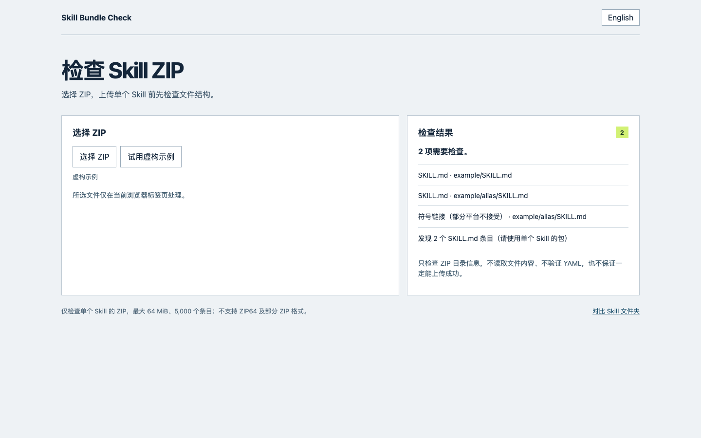
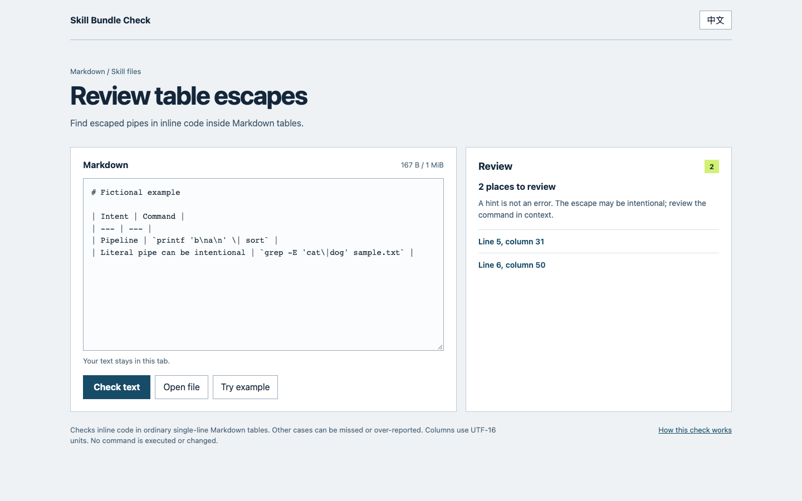
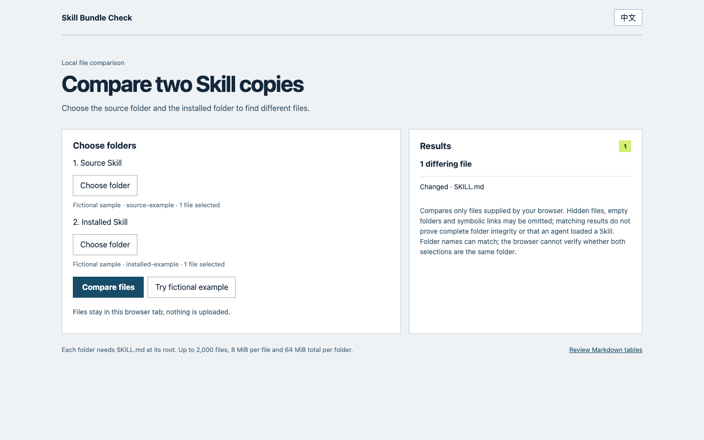

# Skill Bundle Check｜Agent Skill 安装包检查器

**仓库里能用，装进 Agent 之后还好吗？**

[在线对比 Skill 文件夹](https://lydiatools.github.io/skill-bundle-check/web/diff.html?lang=zh) · [检查 Markdown 表格](https://lydiatools.github.io/skill-bundle-check/web/?lang=zh) · [English](README.md)

Skill 包含在插件中？[检查外层插件文件](#plugin-tree)。

不确定 Skill 装在哪里，或安装副本有没有变化？[看排查步骤](docs/where-is-my-skill.zh-CN.md)。

需要上传单个 Skill 的 ZIP？可[在浏览器检查结构](https://lydiatools.github.io/skill-bundle-check/web/zip.html?lang=zh)，也可[用 Python 检查](#检查单个-skill-zip)。

准备安装同名 Skill？先[检查目标路径](#安装前检查目标路径)。

Skill Bundle Check 提供只读检查。`check` 核对源 Skill 引用的本地文件，在安装器或发行流程生成的目录中是否存在且能够解析；它不逐字节比较文件内容，也不证明安装包完整性。`check-agent` 检查目标 Agent 的官方安装目录里有没有对应的 `SKILL.md`，并报告它是否只出现在另一个共享目录。`snapshot` 和 `compare` 对比指定安装目录中的文件存在状态。`diff` 对比两个 Skill 文件夹，`diff-tree` 对比更大的指定目录，包含 Skill 外层的插件文件。`review-pipes` 提示人工检查部分 Markdown 表格转义；`review-shell` 提示复核部分 Shell 示例中的脚本路径。

它不会运行 Skill、启动 Agent，也不会声称 Agent 已在运行时加载了 Skill。

## 为什么做这个工具

社区里已经出现多种 Skill 安装后引用失效的问题：

- [Agent-Reach](https://github.com/Panniantong/Agent-Reach/issues/622)、[Hallmark](https://github.com/Nutlope/hallmark/issues/76) 和 [Tastemaker](https://github.com/codeswithroh/tastemaker/issues/86) 报告过安装或转换后无法取得所引用资源的情况。
- [Addy Osmani 的 agent-skills #468](https://github.com/addyosmani/agent-skills/issues/468) 曾报告完整安装插件后共享文件的相对链接无法解析；[#469](https://github.com/addyosmani/agent-skills/pull/469) 已修复这些链接。[#597](https://github.com/addyosmani/agent-skills/issues/597) 则报告了只安装单个 Skill 时的另一个问题。
- [OpenAI Codex #8364](https://github.com/openai/codex/issues/8364) 报告 Agent 有时找不到引用的脚本，维护者将其关联到另一条问题；该报告没有证明安装目录中的脚本本身缺失。
- [CLI-Anything #331](https://github.com/HKUDS/CLI-Anything/issues/331) 报告安装器只复制 Skill 目录，没有复制它引用的方法文档。
- [Vercel Skills #1851](https://github.com/vercel-labs/skills/issues/1851) 报告全局安装显示成功，但 Skill 被写入共享目录，没有进入 Antigravity CLI 文档所列的全局目录。

格式校验本身未必能发现这类问题。[一份复现记录](https://tinkerhood.com/learn/skill-references-and-assets/) 显示，格式校验通过时，Skill 引用的文件仍可能缺失。本工具直接检查源目录和实际安装目录。

还有一类相关问题不在本工具的检查范围内：[Microsoft APM #2966](https://github.com/microsoft/apm/issues/2966) 报告资源**已经安装**，但生成的 Codex Agent TOML 文件保留了相对于旧位置的链接。`check` 读取 Skill 文件夹中的 Markdown，不检查生成的 Agent TOML，也不证明 Agent 运行时如何解析链接。

结构检查与安全扫描仍然有用。这个工具只补一个检查环节：对比你准备发布的源 Skill 和用户实际安装到的目录。

## 快速开始

无需安装 Node，可在浏览器[对比 Skill 文件夹](https://lydiatools.github.io/skill-bundle-check/web/diff.html?lang=zh)或[检查表格转义](https://lydiatools.github.io/skill-bundle-check/web/?lang=zh)。

需要 Node.js 20 或更高版本。克隆仓库需要联网；文件下载到本机后，运行检查无需额外依赖、账号或网络。

```bash
git clone https://github.com/LydiaTools/skill-bundle-check.git
cd skill-bundle-check
node src/cli.js check ./examples/source ./examples/installed
```

体验多 Agent 更新前后检查：运行 `node examples/update-demo.js`。体验安装副本内容不同：运行 `node examples/diff-demo.js`。它只使用临时目录里的虚构文件。

再运行故意漏文件的安装样例，看看工具如何提示。该命令按预期返回退出码 `1`：

```bash
node src/cli.js check ./examples/source ./examples/installed-missing
```

```text
REFERENCE_MISSING_FROM_INSTALL  installed/SKILL.md:8  Referenced file is missing: references/setup.md

FAIL  2 local references checked
source: 2 Markdown files · installed: 1 Markdown files
```

检查真实安装目录或构建产物：

```bash
node src/cli.js check ./skills/my-skill ~/.agents/skills/my-skill
```

第一个路径是包含 `SKILL.md` 的源目录；第二个路径是安装器或发行流程实际生成的目录。命令仅读取文件，不执行安装脚本或 Skill 代码。

源目录或安装目录可以是指向独立目录的符号链接。检查器会先解析实际目录，再检查包内引用是否越出该目录。在隔离测试中，`skills@1.7.4` 把同一个合成 Skill 同时安装给 Claude Code 和 Cursor 时，为 Claude Code 创建了符号链接；v0.3.0 拒绝这个路径，v0.4.0 能检查它。这不代表所有安装器或平台都会使用符号链接。

检查 Agent 的全局安装目录里是否有某个 Skill：

```bash
node src/cli.js check-agent --agent claude-code --skill my-skill --scope global
node src/cli.js check-agent --agent codex-cli --skill my-skill --scope global
node src/cli.js check-agent --agent antigravity-cli --skill my-skill --scope global
node src/cli.js check-agent --agent antigravity-ide --skill my-skill --scope global
```

检查仓库里的项目级 Skill 时，把 `--scope` 设为 `project`：

```bash
node src/cli.js check-agent --agent claude-code --skill my-skill --scope project
node src/cli.js check-agent --agent codex-cli --skill my-skill --scope project
```

检查其他 Agent 时，直接传入它文档中的 Skills 根目录：

```bash
node src/cli.js check-agent --root ./custom-agent/skills --skill my-skill --scope global
```

目前内置了 `claude-code`、`codex-cli`、`antigravity-cli`、`antigravity-ide` 和 `antigravity-app` 路径，映射依据分别链接到 [Claude Code Skills 文档](https://code.claude.com/docs/en/skills)、[Codex Skills 文档](https://developers.openai.com/codex/skills/) 和 [Antigravity Skills 文档](https://www.antigravity.google/docs/skills)。项目级检查以当前工作目录代表的项目目录为准。目标目录缺少 Skill 时返回退出码 1；如果 Skill 只在 `~/.agents/skills`，报告会同时显示预期路径与实际找到的路径。Antigravity IDE 文档支持的旧路径也会识别。检查文件落点不等于确认 Agent 已在运行时加载或执行 Skill。

如果预期路径中有失效的符号链接，`check-agent` 也会指出它的位置。[一个 Codex 问题](https://github.com/openai/codex/issues/11314)最终确认是相对链接指向错误；本检查只诊断路径，不证明 Agent 已加载。

从 v0.4.0 起，Codex 全局检查同时查看 `~/.agents/skills` 和 `$CODEX_HOME/skills`（默认 `~/.codex/skills`），并列出找到的目录。可设置进程的 `CODEX_HOME`，也可用 `--codex-home /路径/到/codex-home` 指定；使用 `--home` 检查隔离样例时，默认 Codex 目录是该 home 下的 `.codex`。隔离环境中的原生 Codex app-server `skills/list` 测试在两个用户目录各发现了一个合成 Skill。文件存在仍不证明你正在使用的 Agent 已加载该 Skill；不同版本或配置可能不同。

使用仓库内的合成样例复现安装目录不匹配：

```bash
node src/cli.js check-agent --agent antigravity-cli --skill probe-skill --scope global --home ./examples/agent-paths
```

此命令会按预期以退出码 1 结束，并报告 `probe-skill` 只在共享 `.agents/skills` 目录，没有出现在 Antigravity CLI 文档中的全局目录。不会启动 Agent。

## 安装前检查目标路径

两个不同的 Skill 可能同名。[界面设计 Skill unslop 的 Issue](https://github.com/heydamir/unslop/issues/3) 提到了它与写作 Skill 同名；一个[尚在审核的安装说明 PR](https://github.com/heydamir/unslop/pull/5) 描述了递归复制时覆盖现有文件的情况。我们在 macOS 隔离目录中用两个虚构同名 Skill 测试，也观察到后复制的 `SKILL.md` 替换了原文件。

复制前，先核对安装器实际要使用的**确切目标路径**：

```sh
node src/cli.js check-target "$HOME/.claude/skills/unslop"
```

`PRESENT` 表示路径当前已存在，包括空文件夹或失效符号链接，应先检查；`MISSING` 表示检查时某个路径部分不存在；`UNAVAILABLE` 表示无法确认，例如上级是失效链接或不是文件夹。三者退出码分别为 `1`、`0`、`2`；添加 `--format json` 可输出结构化结果。

这是只读的瞬时检查，不会锁定路径、模拟安装、备份文件或保证后续复制安全。请确认实际目标，检查已有文件，在替换前做好备份。输出的路径可能包含个人信息。结果也会受安装器、Shell、文件系统和检查时机影响。

## 检查单个 Skill ZIP

如果唯一的 `SKILL.md` 直接位于 ZIP 根目录，检查页面会向 Claude 网页版和桌面版用户提示顶层文件夹的要求。该提示不检查其余目录结构，也不验证上传结果；v0.14.2 已包含，固定的 v0.14.1 下载包不包含。

使用[下载的 v0.14.2 ZIP](https://github.com/LydiaTools/skill-bundle-check/releases/tag/v0.14.2) 时，解压后在该目录打开终端，运行 `python3 -m http.server 8000 --bind 127.0.0.1`（Windows 可用 `py -3` 替代 `python3`），然后在浏览器打开 `http://127.0.0.1:8000/web/zip.html`。使用 Ctrl+C 停止本地服务。页面在浏览器中读取选中的 ZIP，不会将其发送给服务端。

上传 ZIP 失败时，可先[在浏览器选择文件](https://lydiatools.github.io/skill-bundle-check/web/zip.html?lang=zh)。文件留在当前标签页，只读取 ZIP 目录信息。网页版支持 UTF-8 和 ASCII 文件名，暂不支持旧式非 ASCII 编码和 Unicode Path 扩展字段。



*实际浏览器界面，使用内置虚构示例；截图没有加载真实 Skill。*

也可以使用 Python 3.9+：

```sh
python3 scripts/check_skill_zip.py /path/to/your-skill.zip
```

这个只读检查会列出大小写准确的 `SKILL.md` 数量与路径，并提示 Unix 格式的符号链接、重复路径、加密条目、不安全路径和文件名大小写差异；它不会解压或执行文件。退出码 `0` 表示这些检查没有发现问题，`1` 表示需要查看提示，`2` 表示无法检查。加 `--json` 可输出机器可读报告。

例如，[Humanizer #224](https://github.com/blader/humanizer/issues/224) 曾报告上传包因为符号链接被拒。我们检查了它在提交 [`43c9767`](https://github.com/blader/humanizer/tree/43c97670b563cfa75e4f16ef00c32e933104d10a) 的 GitHub 源码压缩包，本工具发现一个符号链接和两个 `SKILL.md` 条目。上游后来[修复](https://github.com/blader/humanizer/pull/226)并发布了单文件安装包；其 v2.11.1 发行 ZIP 在此检查中没有提示。这是历史案例，不代表当前发行版仍有问题；我们没有把这两个 ZIP 上传到 Claude。

此检查面向**单个 Skill**，不是多 Skill 插件的校验器。不同平台规则可能不同；没有提示也不代表一定能上传或被 Agent 加载。工具只读取目录元数据，不验证 YAML、文件内容、压缩完整性、平台规则或安全性。超过 64 MiB 的包、ZIP64、多卷 ZIP、超过 5,000 个条目、超过 4 MiB 的目录、尾部附加数据和含结束记录标记的 ZIP 注释暂不支持。

## 复核 Shell 示例里的脚本路径

有时审计在错误目录找脚本，就会把实际存在的文件误报为缺失。[HashiCorp 的一条问题](https://github.com/hashicorp/agent-skills/issues/56)后来在评论中被指出属于这种误报。我们核对的历史仓库快照中，该脚本确实存在于 Skill 目录下；当前 `main` 可能已变化。

常规 `check` 会跳过代码块。可以用下面独立的非阻断检查，复核**源目录根部 SKILL.md** 中部分 `./scripts/` 命令在两个目录根部的状态：

```bash
node src/cli.js review-shell ./examples/shell-source ./examples/shell-installed
node src/cli.js review-shell ./skills/my-skill ~/.agents/skills/my-skill --format json
```

随包虚构例子会显示源目录有文件、安装目录缺少文件。这只是相对两个目录根部的观察，**不代表命令一定有问题**：实际执行目录可能不同。检查仅覆盖标明 Shell 语言的代码块中，直接运行的简单 `./scripts/` 路径，以及由 `sh`、`bash`、`zsh`、`python`、`python3` 或 `node` 调用的同类路径；不解析 Shell、不读取其他 Markdown、不执行命令，也不证明文件内容或 Agent 运行情况。可能漏报或多报，最多显示 1,000 条并标明截断。有提示时退出码为 0，输入无效或不可读时为 2；请结合实际执行目录人工判断。

## 试一次虚构的更新

无需安装 Agent Skill，即可体验更新前后检查：

```bash
node examples/update-demo.js
```

示例在新建临时目录中创建两份虚构 Skill，移除其中一份来模拟更新，再调用真实命令。它输出 `claude: found -> found` 和 `codex: found -> missing`；比较命令返回退出码 1；示例正常完成时自身返回 0。运行结束后会清理该临时目录，不会改动你已安装的 Skill。

## 检查表格里的命令

[在线试用表格转义检查](https://lydiatools.github.io/skill-bundle-check/web/?lang=zh) · [English](https://lydiatools.github.io/skill-bundle-check/web/)



网页在当前浏览器中检查粘贴或选取的 Markdown，不执行命令。网页只提供表格转义复核；安装目录和文件引用检查仍需使用命令行。

表格显示的是竖线，Skill 原文中可能带有反斜杠。反斜杠是否正确，取决于命令和正则语法。[GitHub 的表格说明](https://docs.github.com/en/get-started/writing-on-github/working-with-advanced-formatting/organizing-information-with-tables)介绍了转义；[leanrea #1](https://github.com/aicodeking/leanrea/issues/1)报告了复制后表现不同的实例。

```bash
node src/cli.js review-pipes examples/table-pipes.md
node src/cli.js review-pipes /path/to/SKILL.md --format json
```

虚构示例有两个**人工复核提示**，其中一个是可能有意匹配竖线的正则。结果给出文件、从 1 开始的行号和 UTF-16 列号（反斜杠位置）。有提示时退出码仍为 0；文件不可读或输入无效时为 2。此近似检查只覆盖普通单行表格中的行内代码，不是完整 Markdown 或 Shell 解析器，可能漏报或多报。最多输出 1,000 条提示，更多时会明确标记截断。转义可能正确，例如 GNU 基本正则的交替；没有提示也不代表命令一定正确。工具不会运行、解释或修改命令，请结合上下文判断。将命令放在表格外的代码块中，可以更方便地对照原文和渲染结果。

## 更新前后检查多个 Agent 的 Skill

同一个 Skill 在更新后可能仍在一个 Agent 的目录，却从另一个目录消失。[Spec Kit #5002](https://github.com/github/spec-kit/issues/5002) 报告了一种 Claude/Codex 配置，已有[修复提案](https://github.com/github/spec-kit/pull/5005)。下面只检查文件，不证明 Agent 已加载 Skill。

在本仓库中运行，更新前后使用相同的 Skill 名和目录：

```bash
node src/cli.js snapshot speckit-git-feature \
  claude=/path/to/project/.claude/skills codex=/path/to/project/.agents/skills > before.json
# 正常更新你的项目后，再运行相同检查：
node src/cli.js snapshot speckit-git-feature \
  claude=/path/to/project/.claude/skills codex=/path/to/project/.agents/skills > after.json
node src/cli.js compare before.json after.json
```

结果区分存在、缺失、断链、不是文件及无法访问。快照中存在缺失、断链或非文件时退出码为 1；比较以更新后的快照为准。任一快照中的无法访问、输入无效或目标不一致时为 2。缺失时仍输出 JSON；需要继续比较时不要用 `&&` 串接。一次隔离的 macOS 复现中，Spec Kit v0.12.4 为 Claude 和 Codex 安装 `speckit-git-feature`；用 v1.2.1 升级两套集成后，将 git 扩展从 1.0.0 更新至 1.0.1，比较结果为 Claude `found → found`、Codex `found → missing`（退出码 1）。这只是指定版本和场景的观察，不代表当前版本或运行时表现。

JSON 内含绝对路径，分享前请检查。多个名称可能指向同一物理目录，不能据此认定存在独立副本。检查不会备份、恢复或阻止删除，也不比较文件内容或证明运行时发现。

## GitHub Actions

先运行你自己的打包或安装步骤，再检查产物：

```yaml
steps:
  - uses: actions/checkout@v4
  - name: Build skill bundle
    run: ./scripts/build-skill.sh
  - uses: LydiaTools/skill-bundle-check@v0.9.0
    with:
      source: ./skills/my-skill
      installed: ./dist/my-skill
```

发现的问题会显示为 GitHub 行内注释。也可以生成本地 JSON 报告：

```bash
node src/cli.js check ./skills/my-skill ./dist/my-skill --format json
```

## 检查内容

- 源目录和安装目录都包含 `SKILL.md`。
- Markdown 和 HTML 中的本地链接在源目录内能找到目标。
- 被引用的文件在安装包的相同相对路径中保留。
- 安装目录中的相对链接仍在包内且可访问。
- 报告绝对路径、缺失文件、失效符号链接和越出包目录的链接，并标出文件与行号。

支持 Markdown 行内链接、引用式链接定义、HTML `href`/`src`，以及行内代码中常见的 `assets/`、`references/`、`scripts/` 路径。Markdown 链接及以 `./` 或 `../` 开头的路径按文档所在目录检查；嵌套文档中不带前缀的行内路径也会检查 Skill 根目录。两个位置都存在时提示人工判断；只有一个存在时检查该位置，但工具无法确认作者原本预期的工作目录。它不会解析所有 Markdown 扩展，也不会执行示例代码。

`check-agent` 检查选定 Skill 的 `SKILL.md` 是否在所选 Agent 的文档路径中。内置路径会附带对应平台文档；自定义根目录按传入路径原样检查。

## 示例

示例目录展示了一个引用文件随 Skill 一起安装的情况：

```text
examples/
├── source/
│   ├── SKILL.md
│   └── references/setup.md
├── installed/
│   ├── SKILL.md
│   └── references/setup.md
└── installed-missing/
    └── SKILL.md
```

`installed-missing/` 演示安装包漏掉 `references/setup.md` 时的真实失败输出。

## 开发

```bash
npm test
```

## 对比源目录和已安装副本

[在浏览器对比选择的文件夹](https://lydiatools.github.io/skill-bundle-check/web/diff.html?lang=zh)，无需安装 Node。文件只在当前标签页处理；浏览器可能不提供隐藏文件、空目录或符号链接，所以结果一致不代表完整目录一致，也不证明 Agent 已加载。网页无法确认两次选择是否来自不同的物理目录。



*图中使用内置的虚构示例。*

```bash
node src/cli.js diff ./skills/my-skill ~/.agents/skills/my-skill
```

在隔离测试中，用 `skills@1.7.4` 以复制模式安装本地 Skill v1，再把源文件改为 v2 后，安装副本仍是 v1。安装器提示本地来源无法自动检查并建议重新添加；`diff` 列出内容不同的 `SKILL.md`。这是一个具体测试，其他版本和安装模式可能不同。[原始问题](https://github.com/vercel-labs/skills/issues/1440)。

如果你在已安装的 Skill 里加过自己的笔记，可以参考这篇[更新前备份、更新后比较的实操说明](docs/local-files-after-update.zh-CN.md)。它基于一条 `gh skill update` 问题报告和一次隔离测试。

明确选择两个各自包含普通文件 `SKILL.md` 的独立目录后，工具只读对比普通文件的字节，输出有差异的相对路径和状态，加 `--format json` 可获取 SHA-256，不输出正文，也不修改文件。退出码 0 表示已比对的文件一致，1 表示有差异，2 表示检查未完成。空目录差异不计入；比较不能判断哪个版本正确、Agent 是否实际加载或执行。

目录内部的符号链接与特殊文件不支持；超过 2,000 个条目、单文件 8 MiB 或每目录总计 64 MiB 时停止，不把部分结果当完整结果。运行期间请不要修改两个目录；这不是抵抗并发恶意替换的原子安全机制。

<a id="plugin-tree"></a>
## Skill 外层还有插件时

Skill 文件一致，外面的插件配置却可能没有装进去。[Vercel Skills #2609](https://github.com/vercel-labs/skills/issues/2609) 记录了一位用户报告的 Claude Code 插件安装问题。在我们的 macOS 隔离测试中，`skills@1.7.4` 只复制了虚构插件内的 Skill；只对比 Skill 会显示一致，而对比插件源目录和安装目录能看到缺失的相对路径。

先用虚构示例体验：

```bash
node src/cli.js diff-tree ./examples/plugin-source ./examples/plugin-installed
```

示例会列出仅存在于源目录的 `.claude-plugin/plugin.json`、`hooks/hooks.json`，以及因 Skill 目录位置变化而不同的路径；预期退出码为 1。实际使用时，请选择真实插件源目录和需要检查的实际安装目录。两个目录都必须存在，源目录至少有一个普通文件。只有相同的相对目录结构才能逐路径匹配；有意调整目录也会显示为差异。`diff-tree` 沿用 `diff` 的读取限制和退出码，但不要求根目录有 `SKILL.md`；它不比较空目录，也不证明插件已加载、钩子已运行或所选路径正确。

## 许可

MIT。代码为本仓库原创；引用的问题记录只是公开问题示例，不代表相关项目维护者背书。
